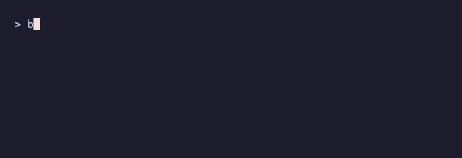
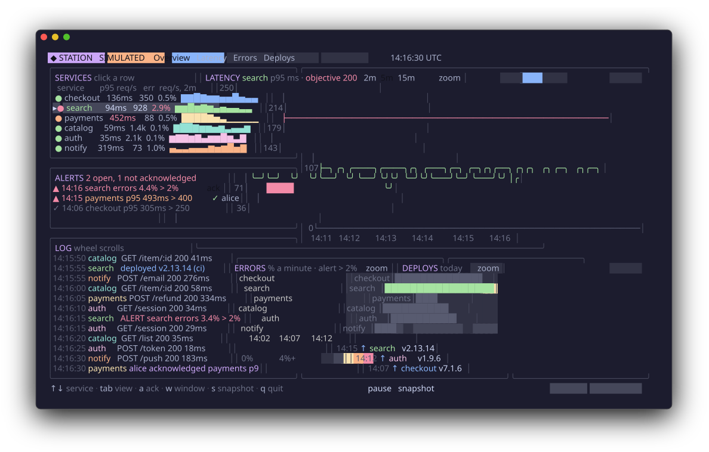
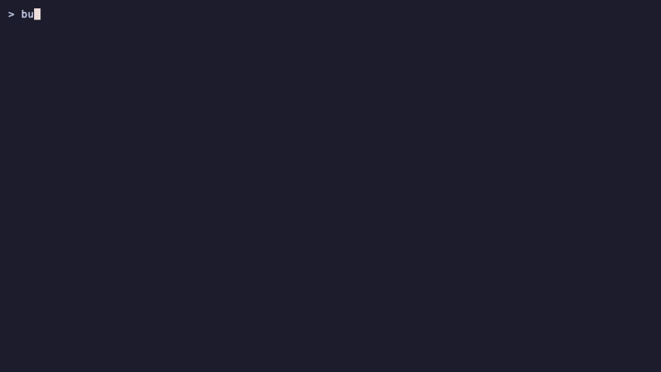
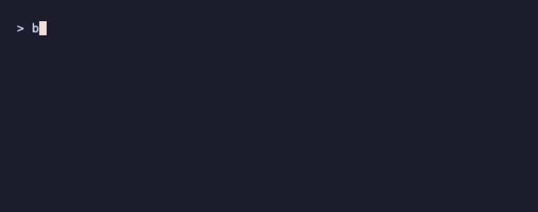
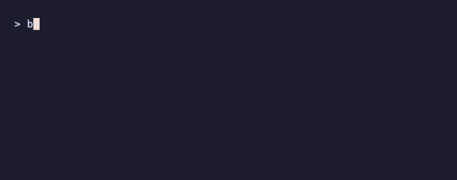
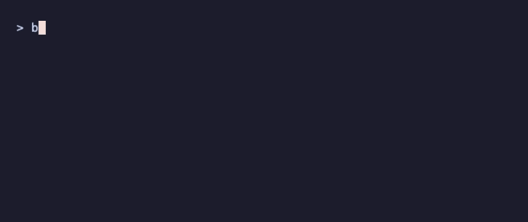

# @oakoliver/bubbletea

An unaffiliated TypeScript port of [charmbracelet/bubbletea](https://github.com/charmbracelet/bubbletea), the Elm Architecture framework for terminal apps. Runs on Node.js and Bun.


A dashboard several people share over SSH: everyone who connects sees the same services and alerts, and each other's pointers. **The services and their numbers are invented and seeded; the header says SIMULATED.** The pointers in the recording are scripted, since a recorder cannot click. It is [`examples/station`](examples/station/), built with this port and five sibling ports. To run it:

```bash
git clone https://github.com/oakoliver/bubbletea && cd bubbletea
bun install --cwd examples                      # the sibling ports the examples use
bun examples/station/main.ts                    # in this terminal (120×34 or more)
bun examples/station/main.ts --serve            # then, from other terminals: ssh -p 2323 <name>@localhost
```

How it is built, step by step: [A Multi-User Terminal Dashboard over SSH in TypeScript](https://engineering.oakoliver.com/articles/getting-started-charm-ports-multi-user-terminal-dashboard-ssh).

The port itself has zero runtime dependencies. Version 1.4.0 targets API and behavior parity with upstream **Bubble Tea v2.1.1**. See [CHANGELOG.md](CHANGELOG.md) for what each upstream sync ported.


**Read the article:** [Getting Started with Bubble Tea in TypeScript](https://engineering.oakoliver.com/articles/getting-started-bubbletea-typescript-terminal-apps) · [Porting Bubble Tea from Go to TypeScript](https://engineering.oakoliver.com/articles/porting-go-bubbletea-to-typescript-elm-architecture-tui-framework)

## Install

```bash
npm install @oakoliver/bubbletea
```

## Quick Start



```typescript
import {
  type Msg,
  type Cmd,
  type Model,
  Program,
  QuitMsg,
  KeyPressMsg,
  Quit,
} from '@oakoliver/bubbletea';

class Counter implements Model {
  constructor(public count: number = 0) {}

  init(): Cmd {
    return null;
  }

  update(msg: Msg): [Model, Cmd] {
    if (msg instanceof KeyPressMsg) {
      const key = msg.toString();
      if (key === 'q' || key === 'ctrl+c') return [this, Quit];
      if (key === 'up') return [new Counter(this.count + 1), null];
      if (key === 'down') return [new Counter(this.count - 1), null];
    }
    return [this, null];
  }

  view(): string {
    return `Count: ${this.count}\n\nPress up/down to change, q to quit.`;
  }
}

const p = new Program(new Counter());
await p.run();
```

### Examples

Runnable programs live in [`examples/`](examples/):

```bash
bun examples/shopping-list.ts  # the Bubble Tea basics tutorial
bun examples/counter.ts        # the Quick Start above
bun examples/countdown.ts      # Tick, Sequence and Println
bun examples/keys.ts           # how KeyPressMsg describes each key
bun examples/window-size.ts    # alt screen + WindowSizeMsg
bun examples/program-status.ts # Program Status Protocol (OSC 7501)
```

The full-screen programs are listed under [Larger Examples](#larger-examples).

The README recordings are made with [@oakoliver/vhs](https://github.com/oakoliver/vhs) from the tapes in [`assets/tapes/`](assets/tapes/).

## Larger Examples

Seven full-screen programs in [`examples/`](examples/) combine Bubble Tea with our ports of [Bubbles](https://github.com/oakoliver/bubbles), [Lip Gloss](https://github.com/oakoliver/lipgloss) and [Glamour](https://github.com/oakoliver/glamour), and the station and the canary with more. To run them, see [Running the larger examples](#running-the-larger-examples).

### station: an ops dashboard shared over SSH

Its recording is at the top of this page. Five more ports work together in [`examples/station/`](examples/station/): [ntcharts](https://github.com/oakoliver/ntcharts) draws a latency time series, a requests-per-second stream, sparklines, an error-rate heatmap and a deploys bar chart; [bubblezone](https://github.com/oakoliver/bubblezone) makes tabs, rows, buttons, heatmap rows and bars clickable; [wish](https://github.com/oakoliver/wish) serves one shared station to every SSH session (`--serve`), so people see each other's pointers and acknowledge alerts together; [freeze](https://github.com/oakoliver/freeze) saves the screen as SVG and PNG (`s` locally, `ssh -p 2323 localhost snapshot > station.svg` over SSH); and [teatest](https://github.com/oakoliver/teatest) runs golden-file tests of the main flows, clicks included. The services and their numbers are invented and seeded; the header says SIMULATED. The pointers in the recording are scripted (`--demo`), since a recorder cannot click.



### canary: a release you approve, with its status in the terminal



[`examples/canary/`](examples/canary/) reports what it is doing with the Program Status Protocol (OSC 7501): working with its progress, blocked on your approval, done, or an error after a rollback. [`host.ts`](examples/canary/host.ts) runs it (or any program) in a pseudo-terminal and shows those reports on a status line, as a terminal that supports the protocol does. The approval is a [huh](https://github.com/oakoliver/huh) form with pre-filled bound values; the charts are [ntcharts](https://github.com/oakoliver/ntcharts) with fixed zone IDs; `s` draws a 4x PNG with [freeze](https://github.com/oakoliver/freeze)'s `renderPNGAsync` while the pipeline keeps moving; [teatest](https://github.com/oakoliver/teatest) checks the screen after `settle()`. The release is invented and seeded.

### chat.ts: a streaming coding-agent chat


A scripted coding agent (no network, no API key) with tool calls, collapsible tool output, three themes and Markdown answers streamed token by token through Glamour. The transcript is rendered the way OpenCode's Bubble Tea TUI did it: each finished part is rendered once and cached under a hash of its inputs, only the part still streaming is re-rendered, and the view follows new output only while you are at the bottom. Walkthrough: [How OpenCode Renders Messages in Bubble Tea](https://engineering.oakoliver.com/articles/how-opencode-renders-messages-in-bubble-tea).

### sysmon.ts: an htop-style system monitor


Per-core CPU bars, CPU and memory history, load average and uptime from `node:os`, and a process table from `ps` that you can sort, filter, open and fold into a tree. Read-only: it has no kill or signal features. `--demo` shows invented data, as in the recording.

### kanban.ts: a board with dialogs and mouse support


Three columns of cards, a live filter, new, edit and delete dialogs drawn as Lip Gloss layers over the dimmed board, and the mouse: click to select, wheel to scroll a column, drag a card to another column. `--file board.json` saves the board after every change.

### blocks.ts: a falling-blocks game


SRS rotation with wall kicks, a 7-bag randomiser, lock delay, hold, a ghost piece, a three-piece preview, levels and a line-clear animation, all driven by one `Tick`. `--autoplay` lets a small heuristic AI play, and `--seed N` repeats a game.

### mission-control.ts: a dashboard


A ports table, test runs with streaming progress bars, bar charts and an event log, on invented data or, with `--live`, on real checkouts of the Charm ports.

### Running the larger examples

They import this repository's source or the published `@oakoliver/bubbletea`, and the sibling ports by name. The ports are not dependencies of `bubbletea`; [`examples/package.json`](examples/package.json) lists them, so one command installs them into `examples/node_modules`:

```bash
git clone https://github.com/oakoliver/bubbletea && cd bubbletea
bun install --cwd examples
bun examples/chat.ts                            # also: sysmon.ts --demo, kanban.ts, blocks.ts --autoplay, mission-control.ts
bun examples/station/main.ts                    # in this terminal (120×34 or more; at least 100×28)
bun examples/station/main.ts --serve            # then, from several terminals: ssh -p 2323 <name>@localhost
ssh -p 2323 localhost snapshot > station.svg    # while it serves: an image of the current state
bun examples/canary/host.ts                     # 100×31 or more; main.ts without the status line
bun test ./examples/station/station.test.ts     # golden-file tests
bun test ./examples/canary/canary.test.ts
```

`npm install --prefix examples` works too. Keys, flags and details for each one are in [`examples/README.md`](examples/README.md).

## Features

- Full Elm Architecture: `init`, `update`, `view` lifecycle
- Keyboard and mouse input parsing (CSI, SS3, SGR, Kitty protocol)
- Alt screen, bracketed paste, focus reporting
- Terminal progress bar (OSC 9;4) and program status (OSC 7501)
- Standard renderer with automatic 60fps flushing
- Commands: `Batch` (concurrent), `Sequence` (ordered), `Tick`, `Every`
- External cancellation via `AbortSignal`
- Raw mode management, SIGINT/SIGTERM/SIGWINCH handling
- Works on Node.js and Bun

## Upstream v2.1.1 Surface Map

The TypeScript API keeps its established camel-case lifecycle (`init`, `update`, `view`, `run`, `send`) while mapping the complete portable v2.1.1 surface (v2.1.0 added the Program Status Protocol on top of v2.0.10; v2.1.1 is a security fix):

| Upstream Bubble Tea | TypeScript surface |
| --- | --- |
| `Model`, `Msg`, `Cmd`, `NewProgram`, `Program.Run/Send/Quit/Kill/Wait` | `Model`, `Msg`, `Cmd`, `NewProgram`, `Program.run/send/quit/kill/wait` |
| `View`, `NewView`, `View.SetContent`, `Cursor`, `NewCursor`, `ProgressBar`, `NewProgressBar` | `View`, `NewView`, `View.setContent`, `Cursor`, `NewCursor`, `ProgressBar`, `NewProgressBar` |
| View alt-screen, mouse, focus, paste, keyboard-enhancement, title, color, cursor, progress, and program-status fields | Corresponding camel-case `View` fields; string-returning legacy models remain supported |
| `ProgramStatus`, `ProgramState*`, `ProgramStatusKind*`, `RequestProgramStatusSupport`, `ProgramStatusSupportMsg` (OSC 7501) | `ProgramStatus` (an object type), the `ProgramState` and `ProgramStatusKind` enums, `RequestProgramStatusSupport`, `ProgramStatusSupportMsg`; `ansi.setProgramStatus`, `ansi.clearProgramStatus`, `ansi.clearProgramStatusID`, `ansi.requestProgramStatusSupport` |
| `Key`, `KeyMsg`, press/release messages, modifiers, special/Kitty key constants | `Key`, `KeyMsg`, `KeyPressMsg`, `KeyReleaseMsg`, `KeyMod`, `KeyCode`, `ExtendedKeyCode` |
| `Mouse`, `MouseMsg`, button and click/release/wheel/motion messages | `Mouse`, `MouseMsg`, `MouseButton`, and the four concrete message classes |
| Focus, paste, window, cursor, mode, color, clipboard, capability, terminal-version, environment, and color-profile reports | Same message names with camel-case fields and methods |
| `Batch`, `Sequence`, `Tick`, `Every`, `Quit`, `Interrupt`, `Suspend`, `ClearScreen`, `Raw`, `Println`, `Printf` | Same exported command names |
| Window/cursor/color/capability/version/clipboard requests | Same exported request and clipboard command names |
| `Exec`, `ExecProcess`, `ExecCommand`, `ExecCallback` | Same concepts; `ExecProcess(command, args, callback)` creates a Node/Bun child process after terminal release |
| `WithContext`, environment/output/input/filter/FPS/profile/window options, signal/panic/renderer options | Same option names; `WithContext` and `WithAbortSignal` accept `AbortSignal` |
| `OpenTTY`, terminal release/restore, program printing | `OpenTTY`, `Program.releaseTerminal/restoreTerminal/println/printf` |

The only omitted exported upstream APIs are `LogOptionsSetter`, `LogToFile`, and `LogToFileWith`. They configure Go's process-wide `log.Default()` object and return an `*os.File`; Node and Bun have no equivalent process-wide logger contract to mutate. Use a Node/Bun logger with an append-mode file stream instead. Terminal suspension remains unavailable on Windows, matching upstream's own `suspendSupported` platform gate.

## The Elm Architecture

Every Bubbletea program revolves around three methods on a `Model`:

1. **`init()`** — Returns an optional command to run at startup.
2. **`update(msg)`** — Receives a message, returns the new model and an optional command.
3. **`view()`** — Returns the current UI as a string or a declarative `View`.

Messages (`Msg`) flow through the event loop. Commands (`Cmd`) are functions that produce messages asynchronously.

## Commands



Commands are functions that return a `Msg` (or a `Promise<Msg>`). Bubbletea executes them asynchronously outside the event loop.

```typescript
import { Batch, Sequence, Tick, Quit } from '@oakoliver/bubbletea';

// Run multiple commands concurrently
const cmd = Batch(cmdA, cmdB, cmdC);

// Run commands sequentially (each waits for the previous)
const cmd = Sequence(cmdA, cmdB, Quit);

// Fire a message after a delay
const cmd = Tick(1000, () => new TickMsg());
```

## Program Options

Configure the program with functional options:

```typescript
import {
  Program,
  WithInput,
  WithOutput,
  WithFilter,
  WithFPS,
  WithAltScreen,
  WithAbortSignal,
  WithMouseMode,
  WithWindowSize,
  WithoutRenderer,
  WithoutSignalHandler,
  WithoutCatchPanics,
  MouseMode,
} from '@oakoliver/bubbletea';

const p = new Program(
  model,
  WithAltScreen(),                   // Start in alt screen mode
  WithMouseMode(MouseMode.AllMotion), // Enable mouse tracking
  WithFPS(30),                        // Custom frame rate
  WithAbortSignal(controller.signal), // External cancellation
  WithFilter((model, msg) => msg),    // Event filter
);
```

With input disabled (`WithInput(null)`), no terminal query is ever sent, since the reply could not be read and would otherwise leak into the shell after exit: `RequestBackgroundColor`, `RequestForegroundColor`, `RequestCursorColor`, `RequestCursorPosition`, `ReadClipboard`, `ReadPrimaryClipboard`, `RequestCapability`, `RequestTerminalVersion`, `RequestWindowSize` (when the output stream has no dimensions), the startup mode probe, and the Kitty keyboard enhancement protocol are all skipped.

As in Go, the startup probe (synchronized output and unicode core mode, `CSI ? 2026 $ p` and `CSI ? 2027 $ p`) depends on the environment, not on whether the output is a terminal: it is written unless input is disabled, `TERM_PROGRAM` names Apple Terminal, or `SSH_TTY` is set (with exceptions for Windows Terminal, ghostty, wezterm, alacritty, kitty and rio). Pass `WithEnvironment` to make it deterministic, for example in tests.

### Colour profiles

Every frame is written in the program's colour profile, as Bubble Tea's renderer does in Go. Views can use 24-bit colours freely: on a 256-colour terminal they become the nearest of the 256 colours, on a 16-colour terminal the nearest ANSI colour, with `Ascii` colours are dropped but bold, italic and underline stay, and with `NoTTY` nothing but the text is written. Lines printed with `println`/`printf` are written as given, as in Go.

The profile is detected at startup from the output and the environment, following Go's `colorprofile.Detect`:

- An output that is not a terminal (a pipe, a file, a stream that is not a TTY) is `NoTTY`, unless `TTY_FORCE` or `CLICOLOR_FORCE` is true. `TERM=dumb` or no `TERM` is `NoTTY` too.
- `NO_COLOR` set to a true value (`1`, `true`, `t`) limits a terminal to `Ascii`.
- Otherwise `COLORTERM`, `TERM`, `WT_SESSION`, `GOOGLE_CLOUD_SHELL` and `TMUX` decide. Unlike Go, the terminfo database and `tmux info` are not read.

`WithColorProfile(profile)` skips detection. A program whose output is a stream that stands for a terminal (an SSH channel, a web terminal) should pass the profile of that terminal, as `@oakoliver/wish` does. The detected or forced profile is reported to the model with a `ColorProfileMsg`.

## Key Input

`KeyPressMsg` carries the parsed key event:

```typescript
if (msg instanceof KeyPressMsg) {
  msg.text;       // Printable character (e.g. 'a')
  msg.code;       // KeyCode enum value
  msg.mod;        // Bitmask: KeyMod.Ctrl | KeyMod.Alt | KeyMod.Shift
  msg.toString(); // Human-readable: 'ctrl+a', 'enter', 'f1'
}
```



Special keys are in the `KeyCode` enum: `Enter`, `Tab`, `Escape`, `Backspace`, `Up`, `Down`, `Left`, `Right`, `Home`, `End`, `PgUp`, `PgDown`, `Insert`, `Delete`, `F1`-`F12`.

## Mouse Input

When mouse mode is enabled, you receive `MouseClickMsg`, `MouseReleaseMsg`, `MouseWheelMsg`, and `MouseMotionMsg`:

```typescript
if (msg instanceof MouseClickMsg) {
  msg.x;      // Column
  msg.y;      // Row
  msg.button; // MouseButton enum
}
```

## Window Size

`WindowSizeMsg` is sent on startup and whenever the terminal resizes:



```typescript
if (msg instanceof WindowSizeMsg) {
  msg.width;
  msg.height;
}
```

As in Go:

- A terminal that reports a size of 0 (some CI runners, serial consoles and new ptys do) falls back to `COLUMNS` and `LINES` from the program's environment (`WithEnvironment`, or `process.env`), then to 80×24, one side at a time.
- An output that is not a terminal has no size to read, and `COLUMNS`/`LINES` are not used for it. This port reports 80×24 there unless `WithWindowSize` says otherwise; Go reports 0×0.
- Implausible sizes are dropped before your filter and model see them: a negative side, a side over 4096, or more than 1,048,576 cells. A size report is input, so this keeps a forged report (`CSI 8 ; 99999 ; 99999 t`) from making the program allocate for a huge screen ([GHSA-qc58-pfg9-7pph](https://github.com/charmbracelet/bubbletea/security/advisories/GHSA-qc58-pfg9-7pph)).

## Program Status

`View.programStatus` reports what the program is doing to terminals that implement the [Program Status Protocol](https://www.superlogical.com/rex/docs/build/program-status) (OSC 7501): idle, working (with optional progress), blocked on the user (and why), done, or failed. Terminals without it ignore the reports.

```typescript
const v = NewView(content);
v.programStatus = {
  state: ProgramState.Working,
  app: 'deploy',
  progress: 40,
  hasProgress: true, // as in Go, progress is sent only with hasProgress
  message: 'Pushing image',
};
```

A report is sent only when the status changes, and `null` clears it. The status is left in place when the program exits, so report `Done`, `Error` or `Idle` before quitting. `RequestProgramStatusSupport` asks the terminal whether it supports the protocol; a `ProgramStatusSupportMsg` comes back if it does, and nothing if it doesn't (input must be enabled). See [`examples/program-status.ts`](examples/program-status.ts).

## External Control

```typescript
const p = new Program(model);

// Send messages from outside
p.send(new CustomMsg());

// Graceful quit
p.quit();

// Immediate kill (throws ErrProgramKilled)
p.kill();

// Wait for the program to finish
await p.wait();
```

## AbortSignal Integration

```typescript
const ac = new AbortController();
const p = new Program(model, WithAbortSignal(ac.signal));

const runPromise = p.run().catch(console.error);

// Cancel from outside
ac.abort(); // Program exits with ErrProgramKilled
```

## API

### Program

- `new Program(model: Model, ...opts: ProgramOption[])` — Create a program.
- `program.run(): Promise<Model>` — Run the event loop. Returns the final model.
- `program.send(msg: Msg): void` — Send a message to the event loop.
- `program.quit(): void` — Send a `QuitMsg`.
- `program.kill(): void` — Immediately kill the program.
- `program.wait(): Promise<void>` — Wait until the program finishes.
- `program.settle(): Promise<void>` — Resolve once every queued message has been handled and its frame written (not in Go; for tests).
- `program.releaseTerminal()` / `program.restoreTerminal()` — Temporarily hand terminal ownership to an interactive process.
- `program.println(...)` / `program.printf(...)` — Print unmanaged lines above an inline view.

### Command Helpers

- `Quit: Cmd` — Command that sends a `QuitMsg`.
- `Batch(...cmds): Cmd` — Run commands concurrently.
- `Sequence(...cmds): Cmd` — Run commands in order.
- `Tick(durationMs, fn): Cmd` — Fire after a delay.
- `Every(intervalMs, fn): Cmd` — Fire once at the next wall-clock interval boundary; schedule it again from `update` for repetition.

### Message Types

- `QuitMsg` — Graceful exit
- `KeyPressMsg` / `KeyReleaseMsg` — Keyboard events
- `MouseClickMsg` / `MouseReleaseMsg` / `MouseWheelMsg` / `MouseMotionMsg` — Mouse events
- `WindowSizeMsg` — Terminal resize
- `FocusMsg` / `BlurMsg` — Terminal focus
- `InterruptMsg` — Ctrl+C / SIGINT
- `SuspendMsg` / `ResumeMsg` — Process suspend/resume
- `ClearScreenMsg` / `PrintLineMsg` — Renderer control
- `EnvMsg` / `ColorProfileMsg` — Startup environment and detected/forced color profile
- `KeyboardEnhancementsMsg` / `ModeReportMsg` — Terminal protocol capability reports
- `ProgramStatusSupportMsg` — The terminal supports the Program Status Protocol
- `ClipboardMsg` / color messages / `CapabilityMsg` / `TerminalVersionMsg` — Query responses

### Errors

- `ErrProgramKilled` — Program was killed via `kill()` or `AbortSignal`
- `ErrProgramPanic` — Unhandled exception in `update()` or a command
- `ErrInterrupted` — SIGINT / Ctrl+C

## Attribution

This is a TypeScript port of [bubbletea](https://github.com/charmbracelet/bubbletea) by [Charmbracelet, Inc.](https://charm.sh), licensed under MIT.

## License

MIT
